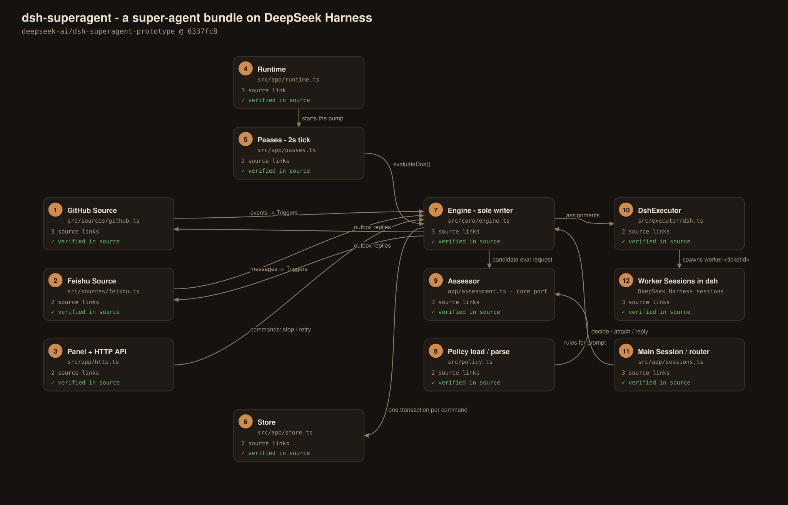
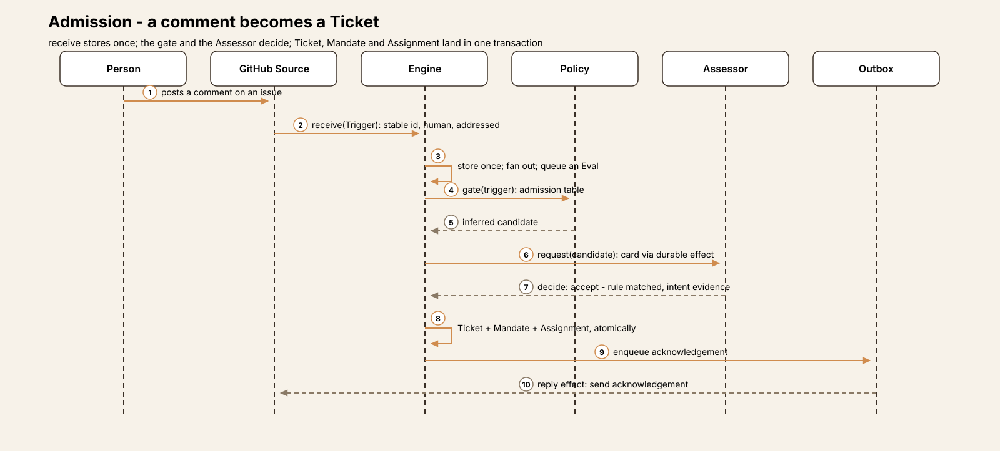
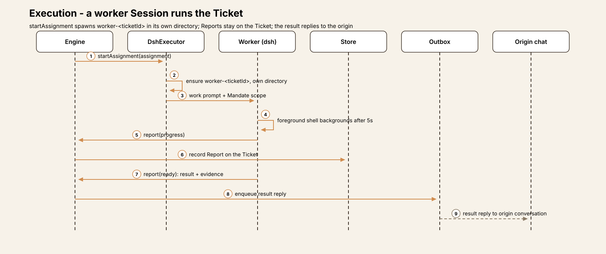
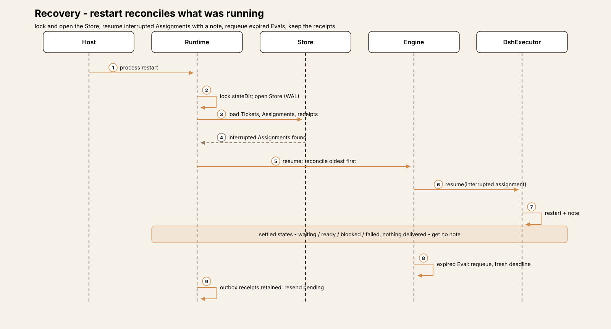
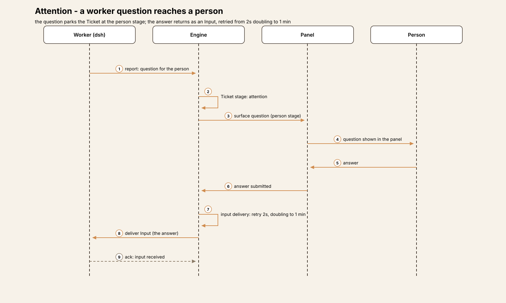
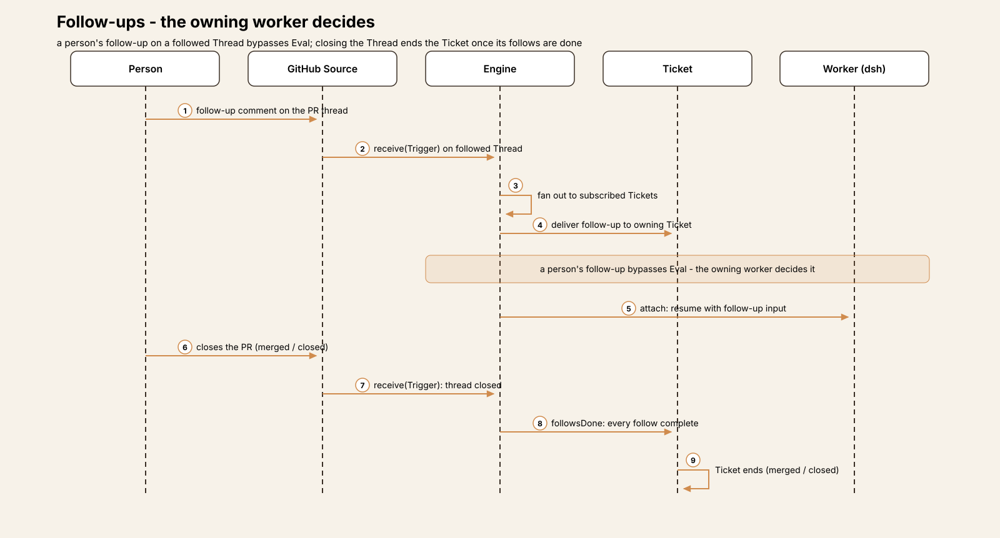

# Agent Harness Anatomy #20: dsh-superagent — the agent that decides whether to act

> **Series:** Agent Harness Anatomy — top-down dissections of real agent harnesses, grounded in verifiable source code. Every behavioral claim below carries a footnote to a pinned GitHub permalink; the full evidence lives in the endnotes.

## Version block

- **Repo:** [deepseek-ai/dsh-superagent-prototype](https://github.com/deepseek-ai/dsh-superagent-prototype)
- **Pinned:** commit `6337fc823ce20251c8de8085948165c81aaa701e` (2026-10-31) — the repository's only commit at the pin; there is no release tag. Version `0.1.0` in `package.json`.
- **Language:** TypeScript — about 15,200 lines in `src/`, plus ~440 lines of prompts and two shipped skills.
- **License:** MIT[^1]
- **Host:** DeepSeek Harness (`dsh`) `^0.2.1-alpha.2` — dsh-superagent ships as a **bundle for dsh** (teardown #15), not as a standalone program.[^2]
- **Claim under test:** a *proactive* coding agent for one GitHub repository. It listens to GitHub (and optionally Feishu), evaluates each request under a written Policy, turns the authorized ones into Tickets, and executes each Ticket in its own dsh Session — under a stated design principle: "take as little human attention as possible, and give as much value as possible."[^3]

Three framing notes. First, this teardown was read-only: the source was cloned and read, never built or executed. Second, the README is unusually candid about provenance: this is a research prototype, "adapted for publication," *not identical* to the internal version, and some designs in the companion article *Exploring Super-agent Design* are future directions that are not implemented in this code.[^4] Where the article text below relies on the paper or the docs rather than the code, it says so; the Observations section collects the gaps the recon found. Third, the single-agent turn loop — the model calls, the tool execution, the session machinery — is dsh's, examined in teardown #15. What dsh-superagent contributes is everything *around* that loop: how work arrives, who is allowed to ask for it, whether it should happen at all, and how a fleet of sessions is supervised. Agensh (#19) is the precedent for this shape: a borrowed loop with a coded system on top. The difference is where the code sits — Agensh's coordination lived in a prompt; dsh-superagent's lives in a transactional domain engine.

## The mental model

Hold four ideas, and the rest is detail.

**A bundle, not a binary.** dsh-superagent loads into a running dsh host as three plugin inserts plus two Session presets, declared in `cordis.patch.yml` and the `dsh.bundle` block of `package.json`.[^2][^5] Its entry point is a Cordis `apply(ctx, config)` that constructs one object, the `Runtime`, and registers the bundle's services on the host context.[^6] Nothing here starts its own process; the operational layer lives inside the harness it supervises.

**The Engine is the only writer.** All durable state — Triggers, Threads, Decisions, Tickets, Assignments — is written by one class, `Engine`, through five internal parts (Intake, Evals, Tickets, Assignments, Replies) in one dependency direction.[^7] Every public method runs as a single synchronous SQLite transaction; callers never see the whole Engine, only a role-scoped slice of it (`EngineForSources`, `EngineForMainSession`, `EngineForPeople`, `EngineForSettings`, `EngineForExecutor`).[^7][^8] Side effects — executor starts, outbound messages, assessor prompts — are enqueued *inside* the transaction and performed by adapters after it commits, so a rolled-back command leaves no trace in the outside world.[^7]

**Authorization is a value, not a check.** When a request is accepted, the Engine does not set a boolean; it mints a `Mandate` — an immutable record of *why* this Ticket may act: who asked, through which basis (addressed to the agent, a follow-up, an admission judgement, a team's standing rule, a bot), under which Policy revision, with what scope.[^9] A person's stop command withdraws the Mandate, and that withdrawal — not a flag on the Ticket — is what ends the authority to work. When processing resumes under changed rules, the Mandate is re-checked before work continues.[^10]

**Two Sessions, two jobs.** The bundle runs one persistent *main Session* (the "router") and one *worker Session per Ticket*. The main Session is deliberately weak: its preset strips file writing, editing, subagents and web access, and its prompt is sixteen lines — route, never implement; never merge.[^11][^12] Its tools are the Engine's commands: route, decide, attach, reply, ask for status.[^13] The workers are the opposite: full tool access, one directory each, running under their own prompt set. The intelligence split is the design — judgement concentrates in one supervised place, capability lives in disposable places.

## The core loop

dsh-superagent's own loop is not a turn loop; it is a *work-management* loop that runs continuously around dsh's sessions:

1. A **Source** polls its platform (GitHub notifications and repository streams, or Feishu chats) and translates each event into a `Trigger` — one immutable record carrying the actor, the text, the Threads it belongs to, and two Source-declared booleans: whether the actor is human, and whether the message addresses the agent.[^14][^15]
2. `Engine.receive` hands the Trigger to **Intake**, which stores it once (duplicates are answered, not reprocessed), fans it out to every Ticket subscribed to its Threads, and — unless a worker already owns the follow-up — queues it for evaluation on its primary Thread.[^16][^17]
3. A **pass** runs every two seconds and whenever anything asks: due effects first, then `Engine.evaluateDue` — expire or requeue stale Evals, resume paused Tickets whose rules now admit them, and start Evals for Threads that are due.[^18][^19]
4. An **Eval** batches a Thread's waiting Triggers and asks the **MasterAssessor** — the main Session, under the admission prompt — for a judgement: accept, stop, ignore, or unavailable.[^20] The judgement is deadline-bound; the deadline starts when the candidate card is *delivered* to the Session, not when it was queued.[^21]
5. On **accept**, one transaction creates the Ticket, its Mandate, its Subscriptions and its first Assignment, queues an acknowledgement, and tells the Executor to start.[^22] One transaction also means one failure mode: all of it, or none of it.
6. The **Executor** runs the Ticket's worker Session in the Ticket's own directory. The worker reports back in a small vocabulary — `progress`, `waiting`, `ready`, `blocked`, `failed`, `dropped` — and the Ticket's stage (queued, working, idle, awaiting answer, awaiting review…) is *derived* from those reports and its follow state, never stored as a status field.[^23][^24]
7. The Ticket ends not when the worker says "done" but when the Threads it follows are done: a `ready` (or `dropped`) report ends it only once every Thread it opened has closed — a merged or closed pull request is the ground truth of completion.[^25]

## One request, end to end

A maintainer comments on an issue in the watched repository, mentioning the agent and asking for a fix:

1. **The comment becomes a Trigger.** The GitHub Source's poll round — notifications first, then repository streams, then open-Ticket PRs, then subscribed Threads — picks the comment up; translation gives it a stable id, a primary Thread (the issue), `human: true` from the account type, and `addressed: true` from the mention of the agent's login.[^15][^26] Delivery is polling, not webhooks: per-Thread cursors with a 14-day horizon, each Thread's failure isolated from the others.[^27]
2. **Intake stores it once.** `receive` deduplicates by Trigger id, correlates the Trigger onto its Threads, and fans it out to subscribed Tickets — there are none for a new issue — then queues it for Eval on the issue's Thread.[^17]
3. **The next pass starts the Eval.** Within about two seconds, `evaluateDue` finds the Thread due, batches its pending Triggers, and the gate classifies this one: a listed person, addressing the agent — the strongest class, judged individually rather than as part of a crowd.[^19][^20]
4. **The assessor judges the ask, not the world.** The candidate card delivered to the main Session carries the Trigger's already-fetched text. The assessor does not fetch the issue, re-check the roster, or re-read the repository at decision time — admission is a judgement over material the Source already collected, which keeps the decision cheap and the evidence fixed.[^21]
5. **Accept mints the Mandate and the Ticket together.** `decide` records the Decision; `Tickets.create` writes the Ticket, its Mandate (basis: `addressed`), its Subscriptions and its first Assignment in one transaction, queues the acknowledgement through the Outbox, and starts the Executor.[^22][^9]
6. **The worker starts in its own directory.** The Executor creates Session `worker-<ticketId>` and a fresh directory for the Ticket, running any team-supplied prepare command first (ten-minute cap; a failed prepare is a recorded failure, not a retry loop).[^28][^29]
7. **Work proceeds without asking permission.** The worker Session runs at dsh's `danger-full-access` preset, as the operator's OS user (see Tradeoffs). A foreground shell command that runs past five seconds is moved to a background job by the worker preset, so the Session can take the next message instead of waiting on a build.[^30][^31]
8. **The result returns to the conversation it came from.** The worker's `ready` report, with the pull request it opened claimed to the Ticket, lets the Ticket end when the PR merges or closes; the result reply goes out through the Outbox to the original issue thread — the only channel writes the core can make, each gated by its own rule.[^25][^32]

## Subsystem inventory

### Admission: the gate first, the judgement second

Admission is two mechanisms wearing one name, and keeping them apart matters. The **gate** is deterministic code: given a Trigger and the current Policy, it classifies the request — an explicit command from an operator; a follow-up from the person a Ticket already serves; an *addressed* ask from a listed person; an *unaddressed* (inferred) candidate from a listed person; an ask from an unlisted person; a bot event.[^33][^34] The defaults are conservative in a specific direction: unlisted people are ignored whether or not they address the agent, and a listed person's unaddressed activity is only ever an *inferred* candidate, never an automatic accept.[^33]

The **judgement** applies only where the gate leaves discretion — the inferred candidates. The main Session, acting as MasterAssessor under the admission prompt, must judge *every enabled rule exactly once*, in a settled direction, and an inferred accept requires quoted `intent_evidence` from the candidate's own text.[^35][^36] A machine-checked rule then decides what an inferred accept is allowed to mean: in the default `observe` accept mode it is recorded as `would_accept` — the system logs what it *would* have done and does nothing — and only in `auto` mode does it create a Ticket.[^35][^37] Even then, the resulting Mandate narrows the worker in code: an inferred Ticket's worker is instructed to keep changes small, internal and single-module.[^38]

Two guards keep the judgement honest. The Eval has a deadline (default 120 seconds, counted from delivery) and a bounded retry budget: an Eval may be requeued at most twice, after which expiry resolves it — silence from the assessor is a decision, not a hang.[^39][^40] And `decide` itself refuses duplicate accepts for a Thread that already has an open Ticket, refuses accepts for Triggers a worker already owns, and refuses inferred accepts the Policy does not admit.[^41]

### The Engine room: one SQLite file, a durable effect queue

Under the Engine sits a single SQLite database (WAL mode, `node:sqlite`) holding the domain tables plus a key registry for every durable cursor — GitHub poll positions, Feishu seen-ids, the runtime's main-Session id.[^42][^43] There is no second store: the effect queue lives in the same file. An **effect** is a durable unit of deferred work — deliver this candidate, start this Assignment, send this reply — with retry state and a failure threshold of three, after which one failure record serves every waiting waiter.[^44] This is what makes the Engine's transaction discipline real: commands commit state and enqueue effects atomically, and the passes pump drains the queue between ticks.[^18]

The **Outbox** is the only path from the core to a person's screen. A send first persists a receipt, then queues a `reply` effect whose retry schedule is 5 seconds, then 300 seconds; sends from one Ticket to one conversation are ordered, so an acknowledgement can never arrive after the result it announces.[^45] Above it, the core's `Replies` part gates each of the four message kinds by its own rule — an acknowledgement only for an accept that created or resumed a Ticket, an answer only against a live question, a result only for the Ticket's own ask, an attention message only when something genuinely needs a person — and makes each send idempotent by deterministic id.[^32]

### The Executor: capability without a permission dialog

The Executor's contract with dsh is one persistent Session and one directory per Ticket, named `worker-<ticketId>` and `<ticketDir>`, reused across the Ticket's Assignments.[^28] Concurrency is slot-based: a Ticket holds a worker slot while an Assignment is pending, delivering, or its worker is busy — including while background work outlives a turn — and follow-ups from a person get one extra slot beyond the configured limit, so a human is never queued behind batch work.[^46] It is worth stating precisely what the configured limit is: `maxWorkers` (default 3) is a settings value; recon found **no hard cap in the Executor code itself**, a point the Observations section returns to.[^47]

Background work has the teardown's most concrete numbers. When a turn ends with shell jobs or subagents still running, the Ticket keeps its slot and stays `working`; completions wake the Session in the same slot. After each turn, background work gets at most **30 minutes**: at the limit, shell jobs are killed (their results readable next turn) while subagents are allowed to continue.[^48][^49] A handoff — a `ready` report, a question, a `blocked` or `failed` report with nothing newer arrived — frees the slot immediately and *leaves the worker's shell jobs running* for the person to inspect, exempt from the 30-minute rule.[^50]

Recovery is reconciliation, not replay. On host restart the Executor resumes interrupted Assignments oldest-first; the Engine restarts each with a recovery note — unless the Assignment had already settled (`waiting`/`ready`/`blocked`/`failed`) with nothing delivered since, in which case it is left exactly as it was.[^51][^52] Inputs that were never taken into Session history survive the shutdown; work that was mid-turn is re-driven from the Assignment, not from a log.

### Sources: polling, idempotent sends, and honest bindings

A Source is a plugin behind a small contract — a settings schema, a scope test, a channel, a Policy part — and the host interface it receives is narrow: `receive`, plus scoped views of threads, tickets and state.[^53][^54] Two kinds ship. The **GitHub** kind covers issues, pull requests, reviews, check runs, releases and workflow runs across the watched repositories; its Policy part is the allowed-people list, the bot list (the agent's own events arrive as bot Triggers and never open work), and per-repository admission rows.[^55] The **Feishu** kind covers group chats and direct messages, is disabled by default in the bundle, and can sync a chat's member roster into the allowed list.[^56]

Two details reward attention. Sends are idempotent *at the platform*: the GitHub channel embeds a `<!-- dsh-superagent:<id> -->` marker in every message it posts and recognizes its own marker on re-read, so a retried send cannot double-post, and a conversation counts as `gone` only on a 410 or a locked-conversation 403.[^57] And a pull request belongs to a Ticket only by an honest binding — it is the PR the Ticket's task came from, or an agent-authored PR on the Ticket's own branch; an unrelated PR that merely mentions the Ticket does not attach.[^58] Follow-ups flow the other way through the same bindings: a person's message on a followed Thread fans out to the subscribed Ticket, bypasses Eval entirely when the Ticket's worker owns follow-ups, and can resume an ended Ticket under its existing Mandate — after the resume-time revalidation.[^10][^59]

### Prompts and presets: where the behaviour actually lives

The bundle's prompts are short and specific. The main Session's sixteen-line prompt makes it a router: read a candidate, route it — accept, attach, stop, ignore — and never implement or merge.[^12] The admission prompt (68 lines) is the inferred-candidate rubric; the dispatch prompt (59 lines) is the routing discipline, exposed to the router as batched tool calls in which each routing item commits in its own transaction, so one bad item cannot poison a batch.[^60][^61] The workers' tool surface is six orchestration verbs — read, ack, thread-unrelated, thread-follow, trigger-handback, report — of which `orchestrator_report` is the load-bearing one: it claims the PR a worker names to its Ticket and records the report atomically with the relay that announces it.[^62]

Team behaviour that in other harnesses would be settings is prompt text shipped in `prompts/team/`: the delivery requirements, for example, demand PR evidence (code changes, tests, docs, in that preference order), permit auto-merge only under 200 changed lines with no blockers, and allow merging only through a separately named merge command — the main Session is prompt-barred from merging at all.[^63]

## Extension points

The bundle is itself the extension: three plugin inserts (the orchestrator plugin and the two Source plugins) patched into dsh's composition, plus a web client injected into the host's UI shell.[^2][^5] Below that, the designed extension point is a new **Source**: the cookbook in `docs/008` gives eleven steps and a checklist whose centre of gravity is translation — turn the platform's events into Triggers with stable ids and honest `human`/`addressed` declarations, implement the channel's idempotent send, and declare the kind's Policy part.[^53][^54] A stricter constraint hides in the validation layer: several operational bounds (the worker limit among them, validated at 1–16) live in a shared `LIMITS` table, so some "configuration" is code by design.[^47] Deployment configuration is deliberately thin — a required `stateDir`, a handful of volatile machine limits — on the philosophy's stated ground that a default replaces a setting when one value suits almost every team.[^64]

## Observations

**The Policy is not an enforcer; it is a library the parts consult.** A reader arriving from the docs expects a central policy engine. The code has none: `src/policy.ts` loads, parses and validates Policy text into projections (a gate function, an admission table, a version hash over rules + mode + Source parts), and enforcement is distributed — the gate's classification in Evals, the assessment validation in the assessor's path, the resume-time re-check in Tickets.[^34][^65] This is a premise correction to the natural summary of this system (and to this teardown's own commissioning brief): "evaluates requests under a Policy" is true, but the evaluating is done by the machine around the Policy, not by a Policy component.

**The assessor judges a fixed record.** Admission reuses the Trigger's stored platform text; the assessor performs no fetching of its own. That is a real design property — decisions are reproducible from the Store — and a real limit: anything the Source's translation dropped is invisible to the judgement.[^21]

**Worker concurrency has no code-level ceiling.** The only cap on simultaneous worker Sessions in the shipped code is the `maxWorkers` setting (default 3, validated 1–16). Any stronger claim — including the companion article's "gentle ramp" for large fleets — is not implemented at this pin and is flagged here as **[UNVERIFIED]** against the code.[^47]

**Three companion-article designs are absent from the code.** The recon searched for them directly: no *competency map* routes work by past performance (routing inputs are Subscriptions, follows and Mandates only); no *progressive trust* mechanism widens or narrows an actor's authority based on history (the gate reads the current Policy text only); and no *self-iteration loop* lets the agent propose changes to its own prompts (prompts change only when an operator re-syncs them from Settings).[^34][^61] These are the paper's stated future directions, and the README states plainly that some of its designs are exactly that. They are recorded here so the teardown's claims stay pinned to the code.

**The docs overstate one component.** `docs/007` places a `Runtime` among the Engine's internal parts; in the code, `Runtime` (in `src/app/`) is the composition root that *constructs* the Engine — the Engine's five parts are Intake, Evals, Tickets, Assignments and Replies.[^7] A small slip, worth noting only because the rest of the documentation is unusually faithful to the code.

## Tradeoffs

- **Capability first, containment by supervision.** Worker Sessions run without approval, as the operator's OS user, at `danger-full-access`; the "blocked commands" mechanism is a set of PATH shims that cannot block `gh`, `git` or `lark-cli` at all and blocks other names by name only.[^30][^66] The repository's own deployment doc draws the conclusion: run it under a dedicated OS account, because that account's reach *is* the agent's reach. What the design offers instead of a sandbox is supervision — one choke-point Engine, an auditable Mandate per Ticket, idempotent and receipted communication, and a stop command that withdraws authority. Whether that trade suits a team depends on how much they trust the admission gate, because everything downstream of accept is trusted completely.
- **Attention discipline is enforced structurally, then trusted rhetorically.** The structural half is strong: four gated reply kinds, one acknowledgement per accept, progress that stays on the Ticket instead of becoming messages, a panel whose stages put "needs a person" first.[^24][^32] The rhetorical half — short messages, one question at a time, honest failure reports — is prompt text, and inherits prompt reliability.[^63]
- **Polling buys simplicity at latency's price.** No webhooks means no inbound surface, durable cursors, and per-Thread failure isolation; it also means admission latency is bounded below by the poll interval plus a pass tick, and the platform API sees a full poll round per interval per repository.[^26][^27]
- **A single-writer Engine in a single SQLite file** makes the state machine auditable and recovery a matter of reconciliation — and caps the design at one host process for one repository, which is, to be fair, exactly the stated scope.[^42]

## Comparison matrix row

| Dimension | dsh-superagent (v0.1.0 @ 6337fc8) |
|---|---|
| Agent loop | Borrowed: the turn loop is DeepSeek Harness's (#15), one Session per worker. The native loop is operational — Source poll -> Trigger -> Eval -> Ticket/Assignment — pumped by 2 s passes (`evaluateDue`) |
| Tool system | Router Session: Engine commands only (route / decide / attach / reply / status / note) under a read-only preset — no file writes, no subagents, no web. Workers: six orchestration verbs (read, ack, thread-unrelated, thread-follow, trigger-handback, report) plus dsh's full tool set under the worker preset |
| Model providers | None of its own: models are whatever the dsh host provides (#15). The bundle's only model-facing choices are its two presets — router and worker |
| Prompt construction | The shipped prompt set is the behaviour layer: `orchestrator.md` (16 lines) for the router, `admission.md` as the inferred-candidate rubric, `dispatch.md`, the worker/work prompts, and `prompts/team/*` for team norms; candidate cards are rendered by the app and delivered to the assessor |
| Memory / session | One SQLite Store (WAL): Triggers, Threads, Decisions, Tickets, Assignments, receipts, cursors, and a durable effect queue in the same file. Ticket stage is derived from reports and follows, never stored; worker Sessions persist per Ticket |
| Reasoning / planning | No planner: one Ticket per accepted request. The assessor judges admission only; decomposition inside a worker Session is dsh's own (subagents under the standard preset) |
| Extensibility | The bundle is itself the extension — a Cordis patch into dsh (3 plugin inserts, 2 presets, an injected web client). New Sources via the `SourceKind` contract and the docs/008 cookbook; team behaviour via prompt files rather than settings |
| Interfaces | Ingress: GitHub (issues, PRs, reviews, CI, releases) and Feishu chats/DMs (disabled by default), both polled. Egress: four gated reply kinds through the Outbox. A web panel whose stages put "needs a person" first |
| Failure handling | Durable effects with retry and a failure threshold of 3; interrupted Assignments resumed with a recovery note (settled ones untouched); expired Evals requeued at most twice, then resolved; sends idempotent by receipt and platform marker; prepare failures recorded, not retried |
| Security model | An admission gate (listed / addressed / bot classes) plus assessor judgement before any work, and a Mandate per Ticket. After accept, workers run without approval as the operator's OS user at `danger-full-access`; blocked commands are PATH shims. Containment is the dedicated account — and a stop that withdraws the Mandate |

## Endnotes

[^1]: License and version: `LICENSE` (MIT, "Copyright (c) 2026 DeepSeek Harness Team") and `package.json` (`"license": "MIT"`, `"version": "0.1.0"`, host `dsh` `^0.2.1-alpha.2`). https://github.com/deepseek-ai/dsh-superagent-prototype/blob/6337fc823ce20251c8de8085948165c81aaa701e/package.json#L1-L40
[^2]: Bundle manifest: `package.json` `dsh.bundle.patch` + client inject list. https://github.com/deepseek-ai/dsh-superagent-prototype/blob/6337fc823ce20251c8de8085948165c81aaa701e/package.json#L1-L40
[^3]: The attention principle: `docs/000-philosophy.md`. https://github.com/deepseek-ai/dsh-superagent-prototype/blob/6337fc823ce20251c8de8085948165c81aaa701e/docs/000-philosophy.md#L1-L10
[^4]: README — research prototype, adapted for publication, not identical to the internal version; some companion-article designs are future directions: https://github.com/deepseek-ai/dsh-superagent-prototype/blob/6337fc823ce20251c8de8085948165c81aaa701e/README.md#L1-L12
[^5]: `cordis.patch.yml` — the three plugin inserts and the two presets: https://github.com/deepseek-ai/dsh-superagent-prototype/blob/6337fc823ce20251c8de8085948165c81aaa701e/cordis.patch.yml#L1-L60
[^6]: Plugin entry `apply(ctx, config)` constructs the Runtime: https://github.com/deepseek-ai/dsh-superagent-prototype/blob/6337fc823ce20251c8de8085948165c81aaa701e/src/index.ts#L1-L27
[^7]: `Engine` — single transactional entry point, five parts, role-scoped views: https://github.com/deepseek-ai/dsh-superagent-prototype/blob/6337fc823ce20251c8de8085948165c81aaa701e/src/core/engine.ts#L16-L45
[^8]: The ports the core depends on: https://github.com/deepseek-ai/dsh-superagent-prototype/blob/6337fc823ce20251c8de8085948165c81aaa701e/src/core/ports.ts#L1-L134
[^9]: `Mandate` and `MandateBasis` — the `via` variants: https://github.com/deepseek-ai/dsh-superagent-prototype/blob/6337fc823ce20251c8de8085948165c81aaa701e/src/core/model.ts#L96-L140
[^10]: `admitsInferred` and `revalidate` — the resume-time Mandate re-check: https://github.com/deepseek-ai/dsh-superagent-prototype/blob/6337fc823ce20251c8de8085948165c81aaa701e/src/policy.ts#L212-L242
[^11]: Router preset — read-only file tools, no subagents/web, 5 s shell limits: https://github.com/deepseek-ai/dsh-superagent-prototype/blob/6337fc823ce20251c8de8085948165c81aaa701e/cordis.patch.yml#L120-L193
[^12]: Main Session prompt — route, never implement; never merge: https://github.com/deepseek-ai/dsh-superagent-prototype/blob/6337fc823ce20251c8de8085948165c81aaa701e/prompts/orchestrator.md#L1-L16
[^13]: Main Session tools (`mainTools`): https://github.com/deepseek-ai/dsh-superagent-prototype/blob/6337fc823ce20251c8de8085948165c81aaa701e/src/app/tools/main.ts#L155-L301
[^14]: `Trigger` — immutable event; `human`/`addressed` Source-declared: https://github.com/deepseek-ai/dsh-superagent-prototype/blob/6337fc823ce20251c8de8085948165c81aaa701e/src/core/model.ts#L23-L40
[^15]: GitHub Trigger translation — stable ids, `human` from account type, `addressed` from a mention: https://github.com/deepseek-ai/dsh-superagent-prototype/blob/6337fc823ce20251c8de8085948165c81aaa701e/src/sources/github-trigger.ts#L55-L108
[^16]: `Engine.receive`: https://github.com/deepseek-ai/dsh-superagent-prototype/blob/6337fc823ce20251c8de8085948165c81aaa701e/src/core/engine.ts#L40-L55
[^17]: `Intake.receive` — dedup, correlation, fan-out, Eval queuing: https://github.com/deepseek-ai/dsh-superagent-prototype/blob/6337fc823ce20251c8de8085948165c81aaa701e/src/core/intake.ts#L16-L63
[^18]: `Passes` — 2 s interval, serialized pump, effects then `evaluateDue`: https://github.com/deepseek-ai/dsh-superagent-prototype/blob/6337fc823ce20251c8de8085948165c81aaa701e/src/app/passes.ts#L22-L69
[^19]: `Engine.evaluateDue`: https://github.com/deepseek-ai/dsh-superagent-prototype/blob/6337fc823ce20251c8de8085948165c81aaa701e/src/core/engine.ts#L65-L90
[^20]: `Evals.start` — batching, gate judgement, `assessor.request`: https://github.com/deepseek-ai/dsh-superagent-prototype/blob/6337fc823ce20251c8de8085948165c81aaa701e/src/core/evals.ts#L71-L130
[^21]: `MasterAssessor` — candidate delivery through the durable `assessment` effect; the assessor reuses the stored Trigger text and performs no fetching: https://github.com/deepseek-ai/dsh-superagent-prototype/blob/6337fc823ce20251c8de8085948165c81aaa701e/src/app/assessment.ts#L85-L115
[^22]: `Tickets.create` — Ticket + first Assignment + acknowledgement + `executor.start` in one transaction: https://github.com/deepseek-ai/dsh-superagent-prototype/blob/6337fc823ce20251c8de8085948165c81aaa701e/src/core/tickets.ts#L29-L70
[^23]: `Assignment` and `ReportState`: https://github.com/deepseek-ai/dsh-superagent-prototype/blob/6337fc823ce20251c8de8085948165c81aaa701e/src/core/model.ts#L206-L230
[^24]: Ticket stages — first matching row wins: https://github.com/deepseek-ai/dsh-superagent-prototype/blob/6337fc823ce20251c8de8085948165c81aaa701e/src/core/stage.ts#L1-L26
[^25]: `Assignments.report` — `ready`/`dropped` end the Ticket via `followsDone`: https://github.com/deepseek-ai/dsh-superagent-prototype/blob/6337fc823ce20251c8de8085948165c81aaa701e/src/core/assignments.ts#L95-L140
[^26]: GitHub polling round — notifications, repository streams, open-Ticket PRs, subscribed Threads: https://github.com/deepseek-ai/dsh-superagent-prototype/blob/6337fc823ce20251c8de8085948165c81aaa701e/src/sources/github.ts#L274-L296
[^27]: Shared polling helpers — 14-day horizon, cursor stepped back 5 s, per-Thread failure isolation: https://github.com/deepseek-ai/dsh-superagent-prototype/blob/6337fc823ce20251c8de8085948165c81aaa701e/src/sources/poll.ts#L1-L40
[^28]: `DshExecutor` — one persistent worker Session and directory per Ticket: https://github.com/deepseek-ai/dsh-superagent-prototype/blob/6337fc823ce20251c8de8085948165c81aaa701e/src/executor/dsh.ts#L1-L35
[^29]: Prepare command — 10-minute timeout, `PrepareFailed` not auto-retried: https://github.com/deepseek-ai/dsh-superagent-prototype/blob/6337fc823ce20251c8de8085948165c81aaa701e/src/executor/dsh.ts#L240-L275
[^30]: Sessions at `danger-full-access` (`Sessions.ensure`): https://github.com/deepseek-ai/dsh-superagent-prototype/blob/6337fc823ce20251c8de8085948165c81aaa701e/src/app/sessions.ts#L137-L155
[^31]: Worker preset — `timeoutMs: 5000` / `maxTimeoutMs: 5000` shell group: https://github.com/deepseek-ai/dsh-superagent-prototype/blob/6337fc823ce20251c8de8085948165c81aaa701e/cordis.patch.yml#L35-L75
[^32]: `Replies` — four gated message kinds, idempotent by deterministic id: https://github.com/deepseek-ai/dsh-superagent-prototype/blob/6337fc823ce20251c8de8085948165c81aaa701e/src/core/replies.ts#L18-L95
[^33]: Admission defaults — `listedUnaddressed: inferred`, unlisted always `ignore`: https://github.com/deepseek-ai/dsh-superagent-prototype/blob/6337fc823ce20251c8de8085948165c81aaa701e/src/admission.ts#L1-L13
[^34]: `settingsPolicy().gate` — the classification paths in precedence order: https://github.com/deepseek-ai/dsh-superagent-prototype/blob/6337fc823ce20251c8de8085948165c81aaa701e/src/policy.ts#L167-L212
[^35]: Assessment validation — every rule judged once, direction settled, `intent_evidence` required, inferred accept outside `auto` becomes `would_accept`: https://github.com/deepseek-ai/dsh-superagent-prototype/blob/6337fc823ce20251c8de8085948165c81aaa701e/src/policy.ts#L30-L66
[^36]: Admission prompt: https://github.com/deepseek-ai/dsh-superagent-prototype/blob/6337fc823ce20251c8de8085948165c81aaa701e/prompts/admission.md#L1-L68
[^37]: `MasterAssessor.decide` — assessment outcome converted into `Engine.decide`: https://github.com/deepseek-ai/dsh-superagent-prototype/blob/6337fc823ce20251c8de8085948165c81aaa701e/src/app/assessment.ts#L265-L282
[^38]: Inferred Mandates narrow the worker (`mandateInstructions`): https://github.com/deepseek-ai/dsh-superagent-prototype/blob/6337fc823ce20251c8de8085948165c81aaa701e/src/executor/dsh.ts#L108-L115
[^39]: Settings schemas — accept mode default `observe`, eval timeout default 120 s, `maxWorkers` default 3: https://github.com/deepseek-ai/dsh-superagent-prototype/blob/6337fc823ce20251c8de8085948165c81aaa701e/src/policy.ts#L79-L106
[^40]: `Evals` — `REQUEUES = 2`, expiry, deadline-from-delivery: https://github.com/deepseek-ai/dsh-superagent-prototype/blob/6337fc823ce20251c8de8085948165c81aaa701e/src/core/evals.ts#L16-L70
[^41]: `Evals.decide` — duplicate-accept, worker-ownership and inferred-accept guards: https://github.com/deepseek-ai/dsh-superagent-prototype/blob/6337fc823ce20251c8de8085948165c81aaa701e/src/core/evals.ts#L131-L175
[^42]: `Store` — SQLite, WAL, schema version 11: https://github.com/deepseek-ai/dsh-superagent-prototype/blob/6337fc823ce20251c8de8085948165c81aaa701e/src/app/store.ts#L51-L110
[^43]: KV key registry — every durable cursor spelled once: https://github.com/deepseek-ai/dsh-superagent-prototype/blob/6337fc823ce20251c8de8085948165c81aaa701e/src/kv.ts#L20-L58
[^44]: `Effects` — durable effect queue, failure threshold 3: https://github.com/deepseek-ai/dsh-superagent-prototype/blob/6337fc823ce20251c8de8085948165c81aaa701e/src/app/effects.ts#L1-L75
[^45]: `Outbox` — receipt first, `reply` effect retry [5 s, 300 s], per-Ticket-per-conversation ordering: https://github.com/deepseek-ai/dsh-superagent-prototype/blob/6337fc823ce20251c8de8085948165c81aaa701e/src/app/outbox.ts#L18-L52
[^46]: `WorkerSlots` — slot accounting, one extra slot for a person's follow-up: https://github.com/deepseek-ai/dsh-superagent-prototype/blob/6337fc823ce20251c8de8085948165c81aaa701e/src/executor/dsh.ts#L166-L201
[^47]: Shared validation bounds — `maxWorkers` validated 1–16; recon found no slot cap implemented in the Executor beyond the settings value: https://github.com/deepseek-ai/dsh-superagent-prototype/blob/6337fc823ce20251c8de8085948165c81aaa701e/src/limits.ts#L1-L11
[^48]: Background limit — `BACKGROUND_LIMIT_MS = 30 * 60_000`; jobs killed, subagents continue: https://github.com/deepseek-ai/dsh-superagent-prototype/blob/6337fc823ce20251c8de8085948165c81aaa701e/src/executor/dsh.ts#L601-L673
[^49]: Background work model — shell jobs and subagents keep the worker busy: https://github.com/deepseek-ai/dsh-superagent-prototype/blob/6337fc823ce20251c8de8085948165c81aaa701e/src/executor/background.ts#L1-L40
[^50]: Handoff frees the slot; shell jobs left running for the person: https://github.com/deepseek-ai/dsh-superagent-prototype/blob/6337fc823ce20251c8de8085948165c81aaa701e/src/executor/dsh.ts#L582-L600
[^51]: `DshExecutor.resume` — interrupted Assignments reconciled oldest first: https://github.com/deepseek-ai/dsh-superagent-prototype/blob/6337fc823ce20251c8de8085948165c81aaa701e/src/executor/dsh.ts#L518-L540
[^52]: `Assignments.interrupted` — restart with a recovery note unless settled: https://github.com/deepseek-ai/dsh-superagent-prototype/blob/6337fc823ce20251c8de8085948165c81aaa701e/src/core/assignments.ts#L79-L94
[^53]: `SourceKind` contract: https://github.com/deepseek-ai/dsh-superagent-prototype/blob/6337fc823ce20251c8de8085948165c81aaa701e/src/sources/kind.ts#L85-L115
[^54]: `SourceHost` / `SourceContext` — the narrow host interface: https://github.com/deepseek-ai/dsh-superagent-prototype/blob/6337fc823ce20251c8de8085948165c81aaa701e/src/sources/host.ts#L28-L67
[^55]: GitHub kind — scope, Policy part (allowed + bots + admission rows): https://github.com/deepseek-ai/dsh-superagent-prototype/blob/6337fc823ce20251c8de8085948165c81aaa701e/src/sources/github.ts#L38-L111
[^56]: Feishu kind — chats/DMs, roster sync, disabled by default in the bundle: https://github.com/deepseek-ai/dsh-superagent-prototype/blob/6337fc823ce20251c8de8085948165c81aaa701e/src/sources/feishu.ts#L31-L105
[^57]: GitHub Channel send — idempotent by the embedded marker; `gone` only on 410 / locked 403: https://github.com/deepseek-ai/dsh-superagent-prototype/blob/6337fc823ce20251c8de8085948165c81aaa701e/src/sources/github-channel.ts#L18-L52
[^58]: PR binding — origin PR or agent-authored PR on the Ticket's branch only: https://github.com/deepseek-ai/dsh-superagent-prototype/blob/6337fc823ce20251c8de8085948165c81aaa701e/src/sources/github-pull.ts#L30-L70
[^59]: `followupOwners` — which Tickets' workers decide a person's follow-up: https://github.com/deepseek-ai/dsh-superagent-prototype/blob/6337fc823ce20251c8de8085948165c81aaa701e/src/core/model.ts#L62-L95
[^60]: Dispatch prompt: https://github.com/deepseek-ai/dsh-superagent-prototype/blob/6337fc823ce20251c8de8085948165c81aaa701e/prompts/dispatch.md#L1-L59
[^61]: `orchestrator_route` — batched routing, each item in its own transaction: https://github.com/deepseek-ai/dsh-superagent-prototype/blob/6337fc823ce20251c8de8085948165c81aaa701e/src/app/tools/main.ts#L122-L154
[^62]: Executor tools — the six orchestration verbs; `orchestrator_report` claims the PR and records the report atomically with its relay: https://github.com/deepseek-ai/dsh-superagent-prototype/blob/6337fc823ce20251c8de8085948165c81aaa701e/src/app/tools/executor.ts#L23-L105
[^63]: Delivery requirements — PR evidence order, the <200-line auto-merge condition, merge only via a named merge CLI: https://github.com/deepseek-ai/dsh-superagent-prototype/blob/6337fc823ce20251c8de8085948165c81aaa701e/prompts/team/delivery.md#L1-L28
[^64]: Deployment config — `stateDir` required, volatile machine limits: https://github.com/deepseek-ai/dsh-superagent-prototype/blob/6337fc823ce20251c8de8085948165c81aaa701e/src/deployment.ts#L14-L30
[^65]: `POLICY_REVISION = 'mandate-v3'`; `policyVersion` covers rules + mode + Source parts only: https://github.com/deepseek-ai/dsh-superagent-prototype/blob/6337fc823ce20251c8de8085948165c81aaa701e/src/policy.ts#L111-L127
[^66]: Blocked commands are PATH shims, not a boundary — `gh`/`git`/`lark-cli` cannot be blocked: https://github.com/deepseek-ai/dsh-superagent-prototype/blob/6337fc823ce20251c8de8085948165c81aaa701e/src/infra/environment.ts#L1-L20
